<picture>
  <source media="(prefers-color-scheme: dark)" srcset="assets/header-dark.svg" />
  <source media="(prefers-color-scheme: light)" srcset="assets/header-light.svg" />
  
</picture>

 

I'm a hands-on engineer who solves real-world problems through clean architecture, automation and full-stack development. I don't just write code: I look at existing systems and workflows, find the friction, streamline the process and make sure what we build fixes a real operational problem.

Beyond Azure cloud infrastructure, CI/CD pipelines, IaC and modern web tech, I've been building agentic AI workflows and local LLM orchestration: smart, automated tooling that handles complex reasoning securely.

<!-- Link buttons: keep on one line with no spaces between them; the equal % slices tile the full width. -->

<a href="https://www.linkedin.com/in/ubihacks/"><picture><source media="(prefers-color-scheme: dark)" srcset="assets/link-linkedin-dark.svg" /><source media="(prefers-color-scheme: light)" srcset="assets/link-linkedin-light.svg" /></picture></a><a href="https://www.instagram.com/ubihacks"><picture><source media="(prefers-color-scheme: dark)" srcset="assets/link-instagram-dark.svg" /><source media="(prefers-color-scheme: light)" srcset="assets/link-instagram-light.svg" /></picture></a><a href="mailto:ubaidifti@gmail.com"><picture><source media="(prefers-color-scheme: dark)" srcset="assets/link-email-dark.svg" /><source media="(prefers-color-scheme: light)" srcset="assets/link-email-light.svg" /></picture></a>

<picture>
  <source media="(prefers-color-scheme: dark)" srcset="assets/pillars-dark.svg" />
  <source media="(prefers-color-scheme: light)" srcset="assets/pillars-light.svg" />
  
</picture>

 
 

**Leading AI adoption** on a large, established codebase that wasn't using AI. The goal is to bring it in securely and in a structured way: across planning, coding, review, testing and release, with humans in the loop and clear guardrails. It speeds up our development process and helps us deliver faster. More importantly, it helps us build a product that is more user-friendly, more reliable and more useful to the people who rely on it.

<picture>
  <source media="(prefers-color-scheme: dark)" srcset="assets/adoption-dark.svg" />
  <source media="(prefers-color-scheme: light)" srcset="assets/adoption-light.svg" />
  
</picture>

 
 

<picture>
  <source media="(prefers-color-scheme: dark)" srcset="https://raw.githubusercontent.com/ubihacks/ubihacks/output/activity-dark.svg" />
  <source media="(prefers-color-scheme: light)" srcset="https://raw.githubusercontent.com/ubihacks/ubihacks/output/activity-light.svg" />
  
</picture>

 
 

<picture>
  <source media="(prefers-color-scheme: dark)" srcset="https://raw.githubusercontent.com/ubihacks/ubihacks/output/wakatime-dark.svg" />
  <source media="(prefers-color-scheme: light)" srcset="https://raw.githubusercontent.com/ubihacks/ubihacks/output/wakatime-light.svg" />
  
</picture>

 

I help teams ship faster, reduce risk and build reliable, maintainable systems. Always learning. Always improving.

Cards refresh every 6 hours. Always happy to talk about cloud architecture, automation and agentic AI.
